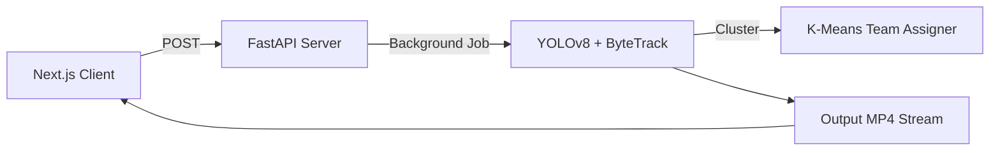

# ⚽ AI Football Analysis Dashboard

**Enterprise-grade computer vision platform for tactical football analysis.**
*Precision · Intelligence · Motion*

---

## 🏗️ Architecture

---

## 🚀 Quick Start
**Backend:**
`uvicorn football_cv.api.server:app --reload`
**Frontend:**
`npm run dev`
