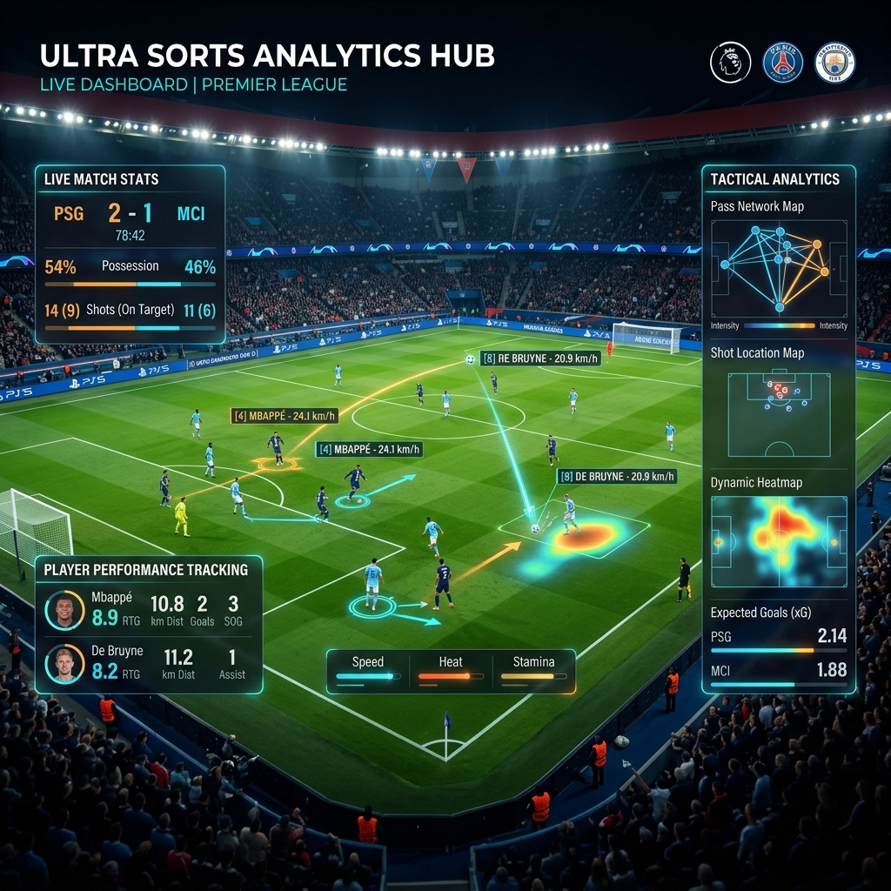
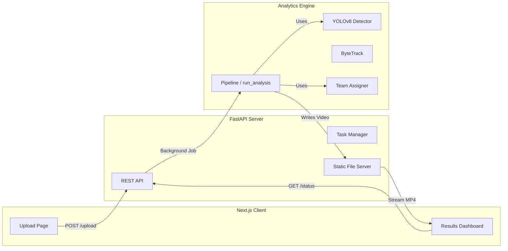

<div align="center">
  
  
  <br/>
  
  
  
  
</div>


---

## 🎨 UI Gallery


---

## 🌟 Features

| Feature | Description | Status |
| :--- | :--- | :--- |
| **🕵️ Deep Analytics** | **YOLOv8x** + **ByteTrack** for SOTA object detection & tracking. | ✅ |
| **⚽ Possession Engine** | Logic-based algorithm with occlusion persistence (10-frame buffer). | ✅ |
| **⚡ Physical Metrics** | Real-time **Speed (px/s)** and **Distance** calculation with smoothing. | ✅ |
| **📊 Visual Analytics** | **Bar & Line Charts** for Possession & Distance (Audi-style design). | ✅ |
| **👕 Team Logic** | Unsupervised **K-Means Clustering** ($k=2$) on HSV + Lab colors. | ✅ |
| **🎨 Premium UI** | **Audi Design System** (Black/Red/White) with tailored components. | ✅ |
| **🚀 Scalable Backend** | Asynchronous **FastAPI** server with background task queues. | ✅ |

---

## 🚀 Quick Start

### 1. Backend (API)
```bash
# Install dependencies
pip install -r football_cv/requirements.txt

# Run Server (Port 8000)
uvicorn football_cv.api.server:app --reload
```

### 2. Frontend (UI)
```bash
# Navigate to frontend
cd frontend

# Install Node modules
npm install

# Run Client (Port 3000)
npm run dev
```

### 3. Usage
-   Open **[http://localhost:3000](http://localhost:3000)**.
-   Upload a match video (`.mp4`).
-   Watch the system analyze possession, teams, and movement in real-time.

---

## 🛠️ Architecture

The system is engineered as a split-stack application:



---

## 📚 Documentation
Detailed guides for developers:

-   **[📖 How to Run](docs/HOW_TO_RUN.md)**: Full setup, troubleshooting, and manual CLI usage.
-   **[🏗️ Reconstruction Guide](docs/DEVELOPMENT_STEPS.md)**: Deep dive into the algorithms and "How it was built".
-   **[📂 Project Tree](docs/PROJECT_TREE.md)**: Map of the file structure.

---

## 📄 License
This project is licensed under the MIT License - see the [LICENSE](LICENSE) file for details.

