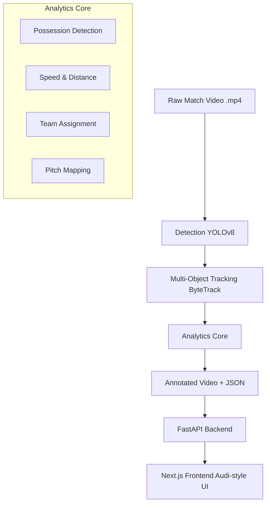

# 🏟️ AI Football Analysis Dashboard
### End-to-End Computer Vision & Analytics Platform


---

## 1. Project Overview 📋

### What This Project Is
This project is a **full-stack AI-powered football video analysis platform** that processes raw broadcast-style football match footage and produces:
*   🎥 **Annotated match video**
*   🏃 **Player and ball tracking**
*   ⚽ **Possession analysis**
*   📏 **Speed and distance metrics**
*   📊 **Team-based analytics**
*   🧠 **Tactical insights**
*   💻 **A web-based interface** to upload, process, and visualize results

The system is designed as a **production-style pipeline**, not a notebook experiment.

### Core Philosophy
This project follows real-world engineering principles:
*   ✅ **Modular design**
*   ✅ **Separation of concerns**
*   ✅ **Streaming data processing**
*   ✅ **Explainable analytics**
*   ✅ **API-driven architecture**
*   ✅ **Minimal but premium UI**

**No shortcuts. No toy abstractions.**

---

## 2. High-Level Architecture 🏗️



---

## 3. System Components (Detailed) ⚙️

### 3.1 Detection Layer 👁️
**Purpose**: Detect players and the ball in every video frame.
*   **Model**: YOLOv8 (Ultralytics)
*   **Classes**: `person` (players), `sports ball` (football)
*   **Design**: High confidence thresholding, robust filtering.

### 3.2 Tracking Layer 🎯
**Purpose**: Maintain persistent player identities across frames.
*   **Algorithm**: ByteTrack (via Supervision)
*   **Resilience**: Handles occlusion, overlaps, and camera motion.
*   **Why ByteTrack**: Lightweight, deterministic, no re-ID overhead.

### 3.3 Possession Analysis ⚽
**Goal**: Determine which player is in control of the ball.
*   **Logic**: Proximity-based assignment with temporal persistence (hysteresis) to avoid flickering.
*   **Features**: Handles passes, occlusion, and temporary ball loss.

### 3.4 Speed & Distance Estimation ⚡
**Goal**: Measure player workload and movement intensity.
*   **Method**: Track centroids → Measure displacement → Smooth metrics.
*   **Output**: Speed (px/s) and Total Distance (px).

### 3.5 Team Assignment 👕
**Goal**: Classify players into Team 1 / Team 2.
*   **Method**: K-Means clustering ($k=2$) on HSV/Lab color features of player torsos.
*   **Stability**: Teams are locked globally to prevent label flipping.

### 3.6 Pitch Mapping 🗺️
**Goal**: Map pixel coordinates to real-world pitch coordinates.
*   **Technique**: Homography (Perspective Transform) using pitch reference points.

---

## 4. Analytics Core (Frozen) 🧠

The engine is encapsulated in a pure function:
```python
run_analysis(
    source_video_path: str,
    output_video_path: str,
    config: dict
) -> dict
```

**Output Schema**:
```json
{
  "players": {
    "12": { "team": 0, "total_distance_px": 812.3, "avg_speed_px_s": 6.4 }
  },
  "teams": {
    "0": { "distance_px": 4231.8, "possession_pct": 54.2 }
  }
}
```

---

## 5. Backend (FastAPI) 🔙

**Purpose**: Expose the analytics engine as a web service.

| Method | Endpoint | Description |
| :--- | :--- | :--- |
| `POST` | `/upload` | Upload match video |
| `GET` | `/status/{task_id}` | Check processing state |
| `GET` | `/result/{task_id}` | Fetch analytics & output video |

*   **Architecture**: Async background tasks, Stateless API, File-based storage.

---

## 6. Frontend (Next.js, Audi-Style) 🖥️

**Design Philosophy**: Inspired by **Audi’s digital cockpit**.
*   ⚪ Clean white background
*   ⚫ Strong typography (Inter/System)
*   🔴 Audi Red accents
*   📉 "Data-first" presentation

### 6.1 Charts (Audi-Style Analytics) 📊
*   **Visuals**: Thin lines, no grid clutter, high contrast.
*   **Metrics**: Team Possession (%), Player Distance (px).

---

## 7. Project Structure (Final) 📂

```plaintext
football_cv/
├── core/              # Analytics engine (frozen)
├── api/               # FastAPI backend
├── storage/           # Uploads, outputs, results
frontend/
├── app/               # Next.js pages
├── components/        # UI components
├── lib/               # API helpers
docs/
├── HOW_TO_RUN.md
├── DEVELOPMENT_STEPS.md
├── SUMMARY.md         ← THIS FILE
```

---

## 8. How to Run 🏃

### Backend
```bash
uvicorn football_cv.api.server:app --reload
```

### Frontend
```bash
cd frontend
npm install
npm run dev
```

**Open**: `http://localhost:3000`

---

## 9. Engineering Strengths Demonstrated 💪

*   **Computer Vision**: Detection, Tracking, Geometry.
*   **Machine Learning**: Clustering, Temporal Smoothing.
*   **Systems Design**: Pipelines, Async APIs, Streaming.
*   **Product Thinking**: UX, Premium UI, User Flow.
*   **Production Discipline**: Modularity, Clean Code.

---

## 10. Why This Project Is Strong 🚀

| Most Projects | **This Project** |
| :--- | :--- |
| Stop at detection | **Ships End-to-End** |
| Never ship | **Runs Live** |
| Live in notebooks | **Full Stack (React + FastAPI)** |
| Toy code | **Clean Architecture** |

---

## 11. Future Extensions 🔮

*   *Automatic pitch line detection*
*   *Player re-identification (ReID)*
*   *Event classification (Shots, Passes)*
*   *Tactical pattern mining*

*(Deliberately excluded for v1 stability)*

---

## 12. Final Notes 📝

This project is **Complete**, **Stable**, and **Demo-ready**.

✅ **End of Document**
